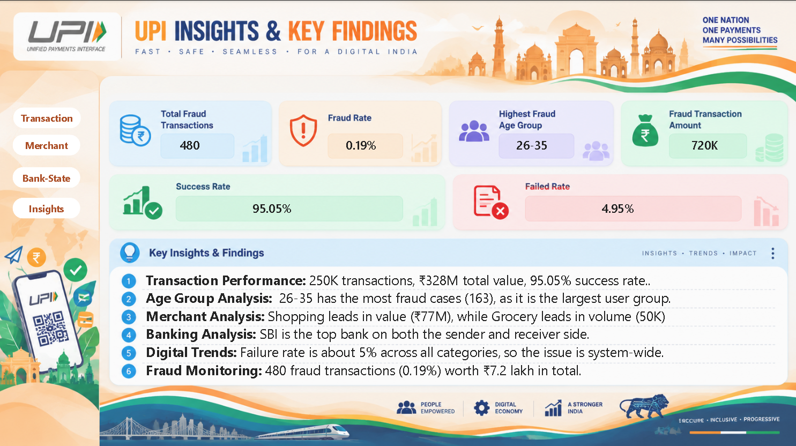

# 📊 UPI Transaction Analytics Dashboard | SQL & Power BI

An interactive Power BI dashboard for analyzing UPI transaction performance, merchant activity, banking patterns, state-wise transactions, and fraud indicators.

> **Dataset Coverage:** Approximately 250K transactions  
> **Total Transaction Value:** Approximately ₹328M  
> **Dashboard Pages:** 4

---

## 🔍 Insights & Key Findings

The dashboard highlights transaction performance and fraud-related indicators available in the dataset.

- **Total Transactions:** 250K
- **Transaction Success Rate:** 95.05%
- **Transaction Failed Rate:** 4.95%
- **Fraud Transactions:** 480
- **Fraud Rate:** 0.19%
- **Highest Fraud Age Group:** 26–35 years
- **Fraud Transaction Amount:** Approximately ₹720K

These findings help identify transaction patterns, monitor failures, and explore fraud-related activity.

---

## 📌 Project Overview

This project uses Power BI to transform UPI transaction data into an interactive dashboard for monitoring transaction performance and exploring patterns across transaction types, merchants, time periods, banks, and states.

The dashboard contains four analytical pages designed to support data exploration and business decision-making.

## 🎯 Project Objectives

- Monitor transaction success and failure rates.
- Compare transaction types and monthly transaction trends.
- Explore transaction activity by hour and day of the week.
- Identify high-volume merchant categories.
- Compare sender-bank and receiver-bank activity.
- Analyze transaction volume and value across states and union territories.
- Highlight fraud-related indicators available in the dataset.

---

## 📊 Dashboard Preview

### 1. Transaction Overview

Provides an overview of transaction volume, success and failure rates, transaction types, monthly trends, and hourly activity.

### 2. Merchant & Time Analysis

Explores merchant-category performance, transaction amounts, failed transactions, and transaction activity across different days and time periods.

### 3. Bank & State Analysis

Compares sender and receiver banks and analyzes transaction distribution across states and union territories.

---

## 📈 Dashboard KPIs

| KPI | Dashboard Value |
|---|---:|
| Total Transactions | 250K |
| Total Transaction Amount | ₹328M |
| Transaction Success Rate | 95.05% |
| Transaction Failed Rate | 4.95% |
| Fraud Transactions | 480 |
| Fraud Rate | 0.19% |
| Total Merchants | 10 |
| Total Banks | 8 |
| Total States/UTs | 10 |

*Values are based on the dashboard and should be interpreted according to the dataset and measure definitions.*

---

## 🛠️ Tools & Technologies

- **Power BI:** Dashboard development and data visualization
- **Power Query:** Data cleaning and transformation
- **DAX:** KPI calculations and analytical measures
- **SQL:** Transaction data analysis and business queries
- **CSV / Excel:** Dataset storage and data handling

---

## 📄 Dashboard Pages

1. **Transaction Overview:** Overall transaction performance and trends.
2. **Merchant & Time Analysis:** Merchant categories and time-based patterns.
3. **Bank & State Analysis:** Banking activity and geographical distribution.
4. **Insights & Key Findings:** Summary of key metrics and fraud-related indicators.

---

## 💡 Business Value

This project demonstrates how transaction data can be analyzed to:

- Monitor transaction performance.
- Identify transaction patterns across time and merchant categories.
- Compare banking and geographical activity.
- Explore fraud-related indicators.
- Present analytical findings through an interactive dashboard.

---

